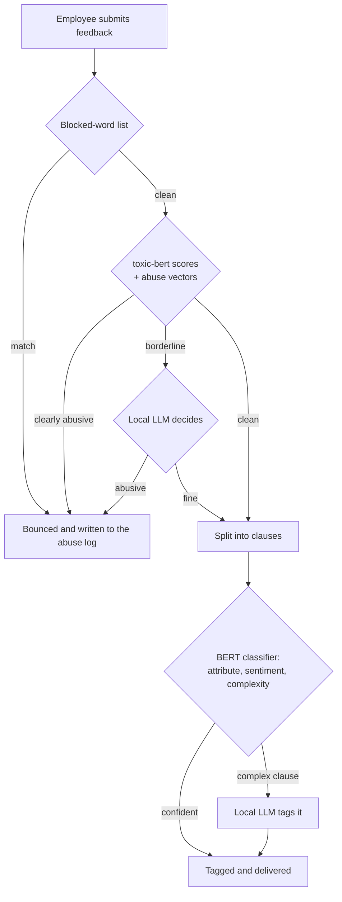

# Feedback System

An anonymous peer-feedback portal for workplaces. Employees write feedback about a colleague, the system checks it for abusive language, works out which work attributes it is about (Leadership, Teamwork, Communication and seven more) and whether it is positive, negative or neutral, and shows the recipient a dashboard of how they are doing.

The language check and the tagging run on your own machine: small BERT models inside the Node.js server, with a local LLM (through [Ollama](https://ollama.com)) for the cases BERT is unsure about. No feedback text leaves your network.

## Contents

- [Features](#features)
- [How a feedback is processed](#how-a-feedback-is-processed)
- [Tech stack](#tech-stack)
- [Before you start the server](#before-you-start-the-server)
- [Setup](#setup)
- [Demo accounts](#demo-accounts)
- [Configuration](#configuration)
- [Project structure](#project-structure)
- [API overview](#api-overview)
- [Retraining the classifiers](#retraining-the-classifiers)
- [Security](#security)
- [Troubleshooting](#troubleshooting)

## Features

**For employees**

- Send anonymous feedback to any colleague (a title and up to 500 characters of text).
- Dashboard with one card per attribute, showing the balance of positive, negative and neutral feedback received.
- Read received feedback, filtered by attribute.
- Ask for a feedback to be re-reviewed, report it as abusive, or report it as irrelevant.
- Change password, reset a forgotten password, light and dark theme.

**For admins**

- Create user accounts. There is no public sign-up.
- Read-only view of all feedback.
- Abuse log of everything that was blocked or removed, with the category and which check caught it.
- Queue of "irrelevant" reports to keep or remove.

**Anonymity**

The sender's ID is stored only while a feedback waits for its language check, so a bounce can be reported back to them. It is erased as soon as the check finishes. The abuse log never holds a sender.

## How a feedback is processed



Feedback is saved first and checked in a background queue, so the sender never waits on a model. Anything left pending by a restart or an LLM outage is picked up again automatically.

Set `CLASSIFIER=llm` to skip the BERT models and send everything to the LLM.

## Tech stack

| Part | Built with |
| --- | --- |
| Frontend | React 19, Vite 8, Tailwind CSS 4, shadcn/ui, React Router 7, Axios |
| Backend | Node.js, Express 5, JWT, bcrypt, Helmet, express-rate-limit |
| Database | MySQL 8 |
| Language models | `Xenova/toxic-bert` and `Xenova/all-MiniLM-L6-v2` through `@huggingface/transformers`, plus `gemma3:4b` through Ollama |

## Before you start the server

The backend refuses to start if the database is unreachable or `JWT_SECRET` is missing or shorter than 32 characters. Work through this list first.

- [ ] **Node.js 20.19+ or 22.12+** and npm are installed (`node -v`).
- [ ] **MySQL 8** is installed and running, and you know a user and password that can create a database.
- [ ] **The database exists**: `databases/schema.sql` has been run, then `databases/seed_feedback.sql` if you want sample feedback.
- [ ] **`backend/.env` exists**, copied from `backend/.env.example`, with `DB_PASSWORD` and `JWT_SECRET` filled in.
- [ ] **Dependencies are installed** with `npm install` in both `backend/` and `frontend/`.
- [ ] **Ollama is installed and running** with the model pulled: `ollama pull gemma3:4b`. The server starts without it, but feedback that needs the LLM stays pending until Ollama is reachable.
- [ ] **Internet access on the first start.** The two BERT models (about 200 MB) are downloaded once into `backend/.model-cache/`. After that the server works offline.
- [ ] **Ports 5000 and 5173 are free** (API and frontend dev server).

## Setup

### 1. Get the code

```bash
git clone <your-repository-url>
cd FeedbackSystem
```

### 2. Create the database

Open a terminal in the project root and run:

```bash
mysql -u root -p -e "source databases/schema.sql"
mysql -u root -p -e "source databases/seed_feedback.sql"
```

`schema.sql` creates the `feedback_system` database, its tables, ten demo users and the ten attributes. `seed_feedback.sql` is optional and adds sample feedback; run it only once, on an empty `feedback` table.

### 3. Configure the backend

```bash
cd backend
cp .env.example .env        # PowerShell: Copy-Item .env.example .env
```

Generate a secret for signing login tokens:

```bash
node -e "console.log(require('crypto').randomBytes(48).toString('hex'))"
```

Then edit `backend/.env`:

```ini
DB_USER=root
DB_PASSWORD=your-mysql-password
JWT_SECRET=the-long-random-string-you-just-generated
```

### 4. Install dependencies

```bash
cd backend && npm install
cd ../frontend && npm install
```

### 5. Start the LLM

```bash
ollama pull gemma3:4b
```

Ollama runs as a background service after installation. If it is not running, start it with `ollama serve`.

### 6. Start the backend

```bash
cd backend
npm run dev      # restarts on changes; use "npm start" for a plain run
```

A healthy start prints:

```
✅ MySQL Database Connected Successfully
🚀 Server running on http://localhost:5000
✅ Language models ready
```

The last line can take a few minutes on the first start while the models download.

### 7. Start the frontend

In a second terminal:

```bash
cd frontend
npm run dev
```

Open <http://localhost:5173> and log in with one of the demo accounts below.

### 8. Check that everything is up

```bash
curl http://localhost:5000/api/health
```

`database`, `llm`, `bertLanguageCheck`, `bertAbuseVectors` and `bertAttributeClassifier` should all be `true`.

## Demo accounts

`schema.sql` creates ten made-up accounts with `@cdis.com` addresses. They all share the password `Password@123`.

| Role | Email |
| --- | --- |
| Admin | `admin@cdis.com` |
| Employee | `aarav@cdis.com`, `priya@cdis.com`, `rohan@cdis.com` and six more (see `databases/schema.sql`) |

> [!WARNING]
> These accounts are for local testing only. Remove them or change their passwords before putting the system anywhere other people can reach it.

To make a hash for a different starting password, edit and run `node scripts/generateHash.js` from `backend/`.

## Configuration

All settings live in `backend/.env`. Only the first block is required.

| Variable | Default | What it does |
| --- | --- | --- |
| `PORT` | `5000` | Port the API listens on |
| `DB_HOST`, `DB_PORT`, `DB_USER`, `DB_PASSWORD`, `DB_NAME` | none | MySQL connection |
| `JWT_SECRET` | none | Signs login tokens. Required, at least 32 characters |
| `JWT_EXPIRES_IN` | `1d` | How long a login lasts |
| `FRONTEND_URL` | `http://localhost:5173` | Used to build password reset links |
| `CORS_ORIGINS` | any origin | Comma-separated list of sites allowed to call the API. Set this outside development |
| `OLLAMA_URL` | `http://localhost:11434` | Where Ollama is listening |
| `OLLAMA_MODEL` | `gemma3:4b` | LLM used for the hard cases |
| `CLASSIFIER` | `hybrid` | `hybrid` uses BERT first and the LLM when unsure; `llm` uses the LLM only |

The thresholds for the toxicity and abuse checks (`TOXICITY_*`, `ABUSE_*`) are documented in [backend/.env.example](backend/.env.example).

The frontend calls the API on port 5000 of whichever host served the page. To point it elsewhere, create `frontend/.env.local` with `VITE_API_URL=http://your-host:5000/api`.

## Project structure

```
├── backend/
│   ├── src/
│   │   ├── server.js        Startup checks, model warm-up, listen
│   │   ├── app.js           Express app, security headers, routes
│   │   ├── routes/          URL to controller wiring and rate limits
│   │   ├── controllers/     Request and response handling
│   │   ├── services/        Auth, language checks, classifiers, background queue
│   │   ├── models/          SQL queries
│   │   └── middlewares/     Auth, roles, ownership, rate limits, errors
│   ├── ml/                  Training data, training and evaluation scripts
│   │   └── model/           Trained weights the server loads at startup
│   └── scripts/             generateHash.js
├── frontend/
│   └── src/
│       ├── pages/           Login, Dashboard, Create/View feedback, Profile, Admin
│       ├── components/      Layout, dashboard cards, forms, UI primitives
│       ├── routes/          Public, protected and admin-only route guards
│       └── services/        Axios client and one module per API area
├── databases/               schema.sql and seed_feedback.sql
└── docs/                    Technical guides and security assessment records
```

## API overview

Every route is under `/api`. All except login, the two password reset routes and the health check need an `Authorization: Bearer <token>` header.

| Method | Path | Purpose |
| --- | --- | --- |
| POST | `/auth/login` | Log in, returns a token |
| POST | `/auth/logout` | Invalidate tokens issued so far |
| POST | `/auth/forgot-password` | Request a reset link |
| POST | `/auth/reset-password` | Set a new password with a reset token |
| GET | `/profile` | Current user's profile |
| PUT | `/profile/password` | Change password |
| GET | `/dashboard` | Attribute summary for the current user |
| GET | `/feedback/recipients` | People you can send feedback to |
| GET | `/feedback/blocked-words` | Word list used for the instant check in the form |
| GET | `/feedback/sent-summary` | How many you sent and how many bounced |
| GET | `/feedback/received` | Feedback you received |
| POST | `/feedback` | Send feedback |
| POST | `/feedback/:id/review` | Ask for a re-review (recipient only) |
| POST | `/feedback/:id/abuse` | Report as abusive (recipient only) |
| POST | `/feedback/:id/irrelevant` | Report as irrelevant (recipient only) |
| POST | `/admin/users` | Create an account (admin) |
| GET | `/admin/feedback` | All feedback, read-only (admin) |
| GET | `/admin/abuse-log` | Blocked and removed feedback (admin) |
| GET | `/admin/irrelevant-reports` | Open irrelevant reports (admin) |
| POST | `/admin/irrelevant-reports/:id` | Decide a report with `{ "decision": "remove" \| "keep" }` (admin) |
| GET | `/health` | Status of the database, LLM and BERT models |

## Retraining the classifiers

The trained weights in `backend/ml/model/` are committed, so the server works without any training. Retrain only after changing the training data. Run these from `backend/`:

| Command | What it does |
| --- | --- |
| `node ml/train.js` | Trains the attribute, sentiment and complexity heads from `ml/labels.csv` and writes `ml/model/weights.json` |
| `node ml/train-abuse.js` | Rebuilds `ml/model/abuse-vectors.json` from `ml/abuse-examples.json` |
| `node ml/evaluate.js` | Scores the classifier on held-out clauses and compares it with the LLM (`--no-llm` to skip that) |
| `node ml/evaluate-abuse.js` | Scores the abuse check |

Pass `--out ml/model/x.json` to either training script for a dry run that leaves the live weights alone. Restart the server to load new weights.

> [!NOTE]
> `ml/profanity.json` and `ml/abuse-examples.json` contain offensive words and sentences. They are there so the system can recognise and block them.

## Security

- Passwords are hashed with bcrypt and must be 8 to 72 characters long.
- Sessions are HS256 JWTs. Logging out or changing a password rejects every token issued before it.
- Rate limits on login, password reset, feedback submission and every authenticated endpoint.
- Helmet security headers, a strict Content-Security-Policy, `Cache-Control: no-store` on every API response, and request bodies capped at 10 kB.
- Role checks on admin routes and ownership checks on actions against a single feedback.
- Reset tokens are stored only as hashes and expire after 30 minutes.

Before deploying beyond your own machine:

- Set `CORS_ORIGINS` to your frontend's address.
- Serve both the frontend and the API over HTTPS.
- Tighten `server.host` and `server.allowedHosts` in `frontend/vite.config.js`, or serve the output of `npm run build` from a real web server that sends the same headers.
- Remove the demo accounts.
- Connect a mail server. Password reset links are currently printed to the backend console instead of being emailed.

## Troubleshooting

| What you see | What to do |
| --- | --- |
| `JWT_SECRET must be set and at least 32 characters long` | Fill in `JWT_SECRET` in `backend/.env` (step 3) |
| `Database Connection Failed` with `Access denied` | Check `DB_USER` and `DB_PASSWORD` in `backend/.env` |
| `Database Connection Failed` with `Unknown database` | Run `databases/schema.sql` (step 2) |
| `Database Connection Failed` with `ECONNREFUSED` | MySQL is not running, or `DB_HOST` / `DB_PORT` is wrong |
| `BERT models could not be loaded, the LLM will be used` | The first start needs internet to download the models. Restart once you are online |
| Feedback stays pending | Ollama is not reachable. Check `curl http://localhost:11434/api/tags` and that `gemma3:4b` is pulled |
| Login page loads but every request fails | The backend is not running on port 5000, or `CORS_ORIGINS` does not include the frontend's address |
| `Too many requests` while testing | Rate limits reset after 1 to 15 minutes, or restart the backend |
| Forgot the local MySQL root password (Windows) | `reset-mysql-password.ps1` resets it and updates `backend/.env`. Read the script first, check its MySQL paths, and run it from an Administrator PowerShell |
